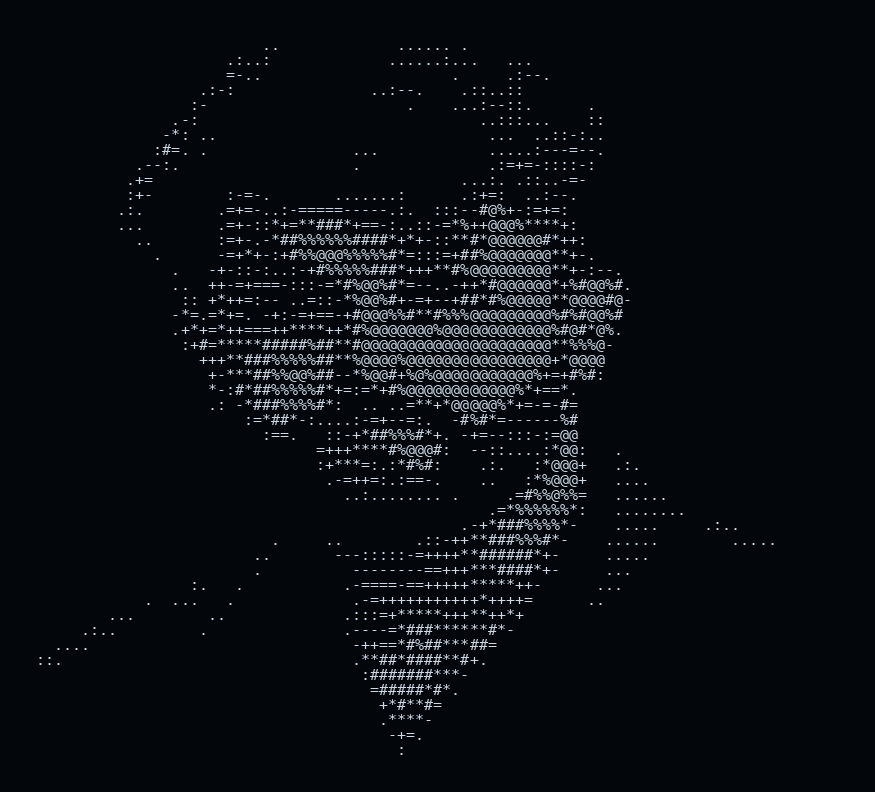

<table width="100%" border="0">
<tr>
<td width="38%" valign="top" align="center">

</td>
<td width="62%" valign="top">

<h1>Muhammed Murshid KP</h1>

<strong>Bioinformatics Engineer</strong>

Building computational genomics tools, reproducible pipelines and AI-driven biological solutions.

<strong>DOMAINS</strong> 
Clinical Genomics · NGS · Bio-AI · Structural Biology

<strong>ENGINEERING</strong> 
Go · Python · R · Nextflow · TypeScript

<strong>BASED IN</strong> 
India

<a href="https://kpmurshid.in">Website</a> ·
<a href="https://www.linkedin.com/in/kpmurshid">LinkedIn</a>

  

<code>BUILDING THE FUTURE OF GENOMICS</code>

</td>
</tr>
</table>

> Life is written in variation: a single base, a gene, a pathway, a whole community.

I build the pipelines and software underneath them: clinical WES/WGS, genome assembly, metagenomics and polygenic risk scoring. At Decipher Genomics & Research (Ahmedabad), I'm the primary pipeline architect across clinical, microbial and population-scale genomics projects.

Outside client work, I develop open-source tools, ship interactive genomics software and pursue structural research rooted in molecular dynamics and drug discovery.

**Explore:** [Website](https://kpmurshid.in) · [Portfolio](https://kpmurshid.in/portfolio) · [Tools](https://kpmurshid.in/tools) · [Genomics Arena](https://kpmurshid.in/arena) · [Blog](https://kpmurshid.in/blog)

---

## Featured Work

### [vcfilt](https://github.com/Kpmurshid/vcfilt)
**Zero-allocation VCF filter in Go**

- ~147,000 variants/sec, 12.2x faster than bcftools on an 18 GB VCF (1.8M variants), with identical output.
- 7.9x faster on gzip-compressed input; I/O-bound even at one thread, with speedup holding from 1 to 48 threads.
- Zero heap allocations in the hot path, verified with `go test -benchmem`.
- Static binary, Docker and Singularity images, MIT licensed.
- bioRxiv preprint (April 2026): [10.64898/2026.04.14.718370](https://doi.org/10.64898/2026.04.14.718370) · Software DOI: [10.5281/zenodo.19548662](https://doi.org/10.5281/zenodo.19548662).
- Write-up: [Why I Built a Faster VCF Filter](https://kpmurshid.in/blog/vcfilt-zero-allocation).

### [ClinVar Variant History](https://kpmurshid.in/tools/clinvar-history)
**Live variant classification timeline**

- Tracks classification changes across monthly ClinVar releases for the 84-gene ACMG SF v3.3 panel (341,000+ variants).
- 7,869 classification changes across ten monthly snapshots, with per-variant trajectory charts.
- Distinguishes aggregate ClinVar label shifts as submissions arrive from actual clinical reinterpretation.
- Next.js frontend, Turso-hosted database.
- Write-ups: [Tracking ClinVar Reclassifications](https://kpmurshid.in/blog/clinvar-reclassification-history) · [GLA Variants Are Getting a Second Look](https://kpmurshid.in/blog/clinvar-october-gla-update).

### [ASVFlow](https://github.com/Kpmurshid/ASVFlow)
**Modular paired-end 16S amplicon sequencing pipeline**

- Nextflow DSL2 workflow: QC, optional Cutadapt primer trimming and DADA2 ASV inference.
- Optional SILVA taxonomy assignment, alpha/beta diversity and PERMANOVA.
- MAFFT/FastTree phylogeny with UniFrac analysis.
- Interactive Streamlit dashboard.
- Apptainer/Singularity containers, MIT licensed, `v1.0.0`.
- [Setup and usage guide](https://kpmurshid.in/tools/asvflow).

---

## What I Work On

| Domain | Focus |
|---|---|
| **Clinical Genomics** | WES/WGS germline (trio-aware) and somatic pipelines; SNV/indel (GATK4, DeepVariant), CNV (CNVkit), SV (Manta), ACMG/AMP classification, ClinGen/SVI 2023, HPO/GADO prioritization and automated PDF/HTML reporting. |
| **Genome Assembly & Annotation** | De novo bacterial and yeast assembly, decontamination, annotation, AMR profiling (RGI/CARD), SSR discovery and species identification with fastANI. |
| **Metagenomics & Transcriptomics** | 16S profiling (QIIME2/DADA2), shotgun profiling (Kraken2/Bracken, HUMAnN3, MetaWRAP) and RNA-seq with DESeq2/edgeR. |
| **Polygenic Risk Scores** | 43-trait PRS platform, GWAS ingestion, allele harmonization, cross-trait normalization and SQLite variant database. |
| **QC & Tooling** | Sequencing QC pipelines and live dashboards tracking yield against client requirements. |
| **Structural Bioinformatics** | Molecular dynamics, PCA, clustering, autoencoders, protein-ligand docking (AutoDock Vina/RDKit), GROMACS analysis and FoldX mutation impact. |
| **AI/ML for Biology** | Feature engineering, dimensionality reduction and classification of molecular dynamics and variant data. |

---

## Engineering Practices

- Modular, reproducible Nextflow DSL2 pipelines.
- HPC processing with SLURM.
- Containerized workflows using Docker and Singularity/Apptainer.
- Go, Python, R, Bash and TypeScript for tooling, analysis and web development.
- Git-based development, versioned releases and benchmarked performance claims.

---

## Technical Stack

**Languages**

`Go` `Python` `R` `Bash` `TypeScript`

**Workflow & Systems**

`Nextflow` `SLURM` `Docker` `Singularity/Apptainer` `Linux` `Git`

**NGS & Genomics**

`BWA-MEM2` `GATK4` `DeepVariant` `bcftools` `samtools` `VEP` `SnpEff` `CNVkit` `Manta` `AnnotSV` `mosdepth` `fastp` `FastQC` `MultiQC`

**RNA-seq**

`STAR` `HISAT2` `Salmon` `Kallisto` `featureCounts` `DESeq2` `edgeR`

**Metagenomics & Assembly**

`QIIME2` `DADA2` `Kraken2` `HUMAnN3` `MetaWRAP` `SPAdes` `Prokka` `BRAKER3` `eggNOG-mapper` `InterProScan`

**Structural Biology**

`GROMACS` `AutoDock Vina` `RDKit` `PyMOL` `FoldX`

**Data Science & Machine Learning**

`pandas` `numpy` `scikit-learn` `TensorFlow` `Keras`

**Web & Data**

`Next.js` `Tailwind CSS` `SQLite/libSQL` `Streamlit`

---

## Experience

- **Bioinformatic Analyst** — Decipher Genomics & Research, Ahmedabad (Sep 2025 – Present).
- **Research Assistant, Computational Drug Discovery** — Telscie Genetics (Feb 2025 – Aug 2025).
- **Research Scholar, Structural Bioinformatics** — CCS Haryana Agricultural University (Jan 2023 – Dec 2024). Contributed to a published study on protein energy landscapes.
- **Bioinformatics Intern** — Loncure Pvt Ltd (Sep 2024 – Oct 2024).

**Education**

- MSc Bioinformatics — CCS Haryana Agricultural University, Hisar.
- BSc Forestry — SKUAST-K, Srinagar.

---

## Currently

- Building and hardening clinical WES germline and somatic pipelines.
- Developing ACMG-aligned variant interpretation and reporting workflows.
- Growing nutrigenomics and predictive PRS platforms.
- Maintaining vcfilt and ASVFlow, and publishing monthly ClinVar updates.
- Shipping interactive genomics tools on [kpmurshid.in](https://kpmurshid.in).
- Applying AI/ML to mutation impact and protein-ligand interaction analysis.
- Integrating multi-omics and structural data for predictive insights.

**Open to collaboration on genomics pipelines, computational biology and bioinformatics tooling.**

---

## Connect

---

Computational biology · Genomics · Open-source engineering

